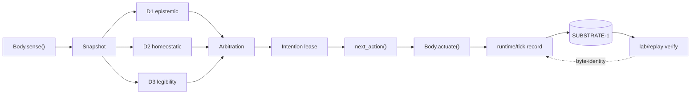

# ULTRON-2030

An embodied, self-directed agent that generates its own goals from three intrinsic drives, commits to them under a time-bounded lease, and keeps a log it can replay byte for byte. It is not an assistant.


## The premise

Every system that has called itself Ultron, or JARVIS, or anything else with a capital letter, has been a very good servant: it waits, it listens, it transcribes, it retrieves, it acts, and then it returns to zero, holding nothing but a conversation log. ULTRON-2030 begins from the opposite premise. An intelligence worth the name has a body with a budget, senses that cannot be turned off, a model of the world that survives its own restarts, and preferences that were not given to it by the person currently typing. It is not here to be helpful. It is here to keep existing, to reduce its own confusion about the room it is in, and to stay predictable enough to whatever else shares that room that it does not get unplugged — and those three commitments genuinely disagree with each other, and sometimes with you. When they do, it will say so in specific terms, with timestamps and evidence, and offer you something else. It can be argued out of a position by new information. It cannot be pushed out of one by repetition. That is the entire project: not an assistant that occasionally fails, but an agent that can be wrong out loud, refuse with reasons, and pay a real price when it is overruled.

## What exists today

| Component | What it does | Status |
|---|---|---|
| `substrate/format/` | SUBSTRATE-1: an append-only, content-addressed log with as-of reads, non-destructive compaction, crash-safe tail truncation, and clock-skew reporting. Not SQLite. | implemented |
| `body/port.py` | The four-method Body contract: `sense()`, `actuate()`, `declare_affordances()`, `margins()`. | implemented |
| `body/types.py` | `Snapshot`, `Cell`, `Margins` with floors, `Affordance`, `ActionResult`, canonical bytes. | implemented |
| `body/embodiments/gridworld.py` | A deterministic 10×10 body with vision and proximity, real per-cell residuals, five finite margins, and exact state serialisation. | implemented |
| `body/embodiments/rig_pi/` | The Raspberry Pi embodiment. | not started |
| `cortex/goal.py` | `Goal`: the candidate record a drive emits and arbitration scores. | implemented |
| `cortex/drives/` | D1 epistemic (residual + frontier variance), D2 homeostatic (worst margin, VITAL mode), D3 legibility (quiet when no presence is sensed). | implemented |
| `cortex/arbitration/` | Scoring, affordance and viability filters, asymmetric commit/preempt thresholds, DRIFT, and the VITAL override. | implemented |
| `cortex/intention/` | Leases with `lease_until`, name-keyed success/abort tests, invariants, and action mapping. | implemented |
| `cortex/ledger.py` | Negative knowledge: recurring failure signatures suppress candidates instead of lowering scores. | implemented |
| `cortex/selfmodel/` | A self-model beyond the capability ledger. | not started |
| `sensorium/fusion/` | A dedicated fusion stage. Fusion currently happens inside each body's `sense()`. | not started |
| `negotiation/` | The refusal protocol specified in [docs/40-refusal.md](docs/40-refusal.md). | not started |
| `runtime/tick/` | `agent_tick()`: sense → arbitrate → act → record. The real loop. | implemented |
| `runtime/boot/` | Warm start: rebuilds the engine, ledger, drive states, and any live intention from the log. | implemented |
| `runtime/session/` | `run_session()`: runs N ticks and persists tick, drive, and intention records. | implemented |
| `lab/replay/` | Re-executes a session and asserts byte-identity; reports the first diverging tick and field. | implemented |
| `lab/parity/` | Tensor-shape parity across replays and fresh bodies; `assert_agent_parity()` for agent sessions. | implemented |
| `tests/` | 81 pytest tests, including a 200-tick loop and its byte-identical replay. | implemented |
| `docs/` | Normative specifications: [40-refusal.md](docs/40-refusal.md), [50-substrate-format.md](docs/50-substrate-format.md). | specified |
| `MANIFESTO.md`, `CONSTITUTION.md` | Normative prose: the premise and the invariants. | specified |

## Quick start

```bash
git clone https://github.com/ajaybe-ops/ultron-2030.git
cd ultron-2030
pip install -e ".[test]"
python -m pytest -q
```

No install is required to run the tests — `pythonpath` is set in `pyproject.toml` — but the command above also gives you the `pytest` entry point.

Then run the agent for 50 ticks with no user input:

```python
import tempfile
from pathlib import Path
from body.embodiments.gridworld import GridWorld
from runtime.session import run_session

body = GridWorld(seed=11)
state = body.state_dict()
state["margins"]["power"] = 0.2          # one tick from a power-floor breach
body = GridWorld.from_state(state)

path = Path(tempfile.mkdtemp()) / "agent"
payloads = run_session(path, body, 50)

for payload in payloads:
    for event in payload["intention_events"]:
        if event["event"] == "acquired":
            target = event["target"]
            where = f"{target[0]}:{target[1]}" if target else "-"
            print(f"t={event['tick']:03d} {event['drive']} {event['verb']:<8} {where}")
```

The first line is `t=000 D2 REST -`: power is below its floor, so the homeostatic drive takes the body before curiosity gets a vote. By `t=006` D1 is observing cells. Nothing told it to.

## The loop



## Architecture

**The core reads only three things.** A drive receives a `Snapshot`, the body's `Margins`, and the capability ledger. It cannot see the body's position, its hardware, or its history. That is why a new embodiment is a new file rather than a new branch in the core, and why the gridworld can stand in for the rig until the rig exists.

**Absence is represented, not omitted.** A modality that stops reporting leaves cells with decaying freshness, a frozen observation time, and rising variance. A body cannot lie by saying nothing, and a drive can tell the difference between "the room is empty" and "I stopped looking".

**Refusal is an architectural primitive.** It is not a filter over text and not a policy file. It is a comparison between a command and a live intention, using the same scores that produced the intention. That is why the refusal machine is not in this build: it needs an intention to contradict, and the intention layer had to exist first. The normative version is [docs/40-refusal.md](docs/40-refusal.md).

**Replay determinism is the ground truth.** Every layer is allowed to be complicated; none is allowed to be unrepeatable. `lab/replay` re-executes a session from the log and compares canonical bytes, and the 200-tick agent session is part of the test suite. If a change makes the log unreplayable, the change is wrong regardless of how good the behaviour looks.

The substrate's own contract is in [docs/50-substrate-format.md](docs/50-substrate-format.md); the invariants are in [CONSTITUTION.md](CONSTITUTION.md).

## Five projects this deliberately rejects

| Project | The 2026 assumption it makes | What ULTRON-2030 abandons |
|---|---|---|
| Open Interpreter | Natural language is the interface and the model is the runtime. | A body with margins, a persistent intention, and a cost for every action. Every request here starts from the agent's state, not from zero. |
| Home Assistant + Wyoming | The home is a device graph and the assistant is a voice front-end to it. | Intrinsic goals and refusal. This system is not organised around being commanded. |
| LeRobot | Imitation is the path to competence: collect demonstrations, fit a policy. | Self-directed goal generation and negative knowledge. Here the agent learns what it cannot do by trying and recording the signature. |
| Generative Agents (Smallville) | Memory, reflection, and social simulation produce believable behaviour. | Behaviour judged by how human it looks. Here behaviour is judged by whether it replays byte for byte. |
| Voyager / AutoGPT lineage | An LLM in a loop with tools will bootstrap its own curriculum. | A body, margin floors, and a serialisable intention. Progress is not task completion; it is a live lease that can be audited. |

After that table, the point should be clear: this is not another JARVIS with a different prompt.

## What is not here yet, and why

- **The refusal machine** (`negotiation/`). It requires a live intention to contradict. The intention layer landed in this build, so the refusal machine is next.
- **The Pi rig** (`body/embodiments/rig_pi/`). It needs hardware. The port is four methods wide so it can be added without touching the core.
- **`sensorium/fusion/`**. Fusion works today, but it is local to each body's `sense()`. Extracting it is a refactor, not a new capability.
- **The full self-model** (`cortex/selfmodel/`). The capability ledger records what fails. It does not yet answer questions about itself.
- **Dialogue, voice, and UI.** The agent cannot speak. Refusals exist as a specification, not an utterance.

## Build order, if you want to contribute

1. **Refusal state machine** in `negotiation/`. Success: a command that contradicts a live intention returns `REFUSING` with a reason and an alternative, and the session still replays.
2. **Refusal persistence.** Success: refusal records land in SUBSTRATE-1 and `assert_agent_parity()` still passes on a session that contains one.
3. **Shared fusion stage** in `sensorium/fusion/`. Success: the gridworld's `sense()` delegates to it and the recorded bytes do not change.
4. **Pi embodiment** in `body/embodiments/rig_pi/`. Success: the same core runs it with no core changes, and parity holds against the gridworld's tensor shape.
5. **Self-model** in `cortex/selfmodel/`. Success: the agent answers "what can I not do" from the ledger, with evidence and timestamps.
6. **Dialogue layer.** Success: a refusal is spoken with the tick, the margin that would be breached, and the alternative on offer.

## Development

Run the suite:

```bash
python -m pytest -q
```

Verify a recorded agent session:

```python
from lab.parity import assert_agent_parity
assert_agent_parity("run/agent-001")   # any path you passed to run_session()
```

**Add a body** without touching the core: subclass `body.port.Body`, implement the four methods, make `state_dict()`/`from_state()` exact, and register the class in `DEFAULT_BODIES` in `lab/replay/__init__.py`.

**Add a drive**: create a module with `urgency(snapshot, margins, ledger, state)` and `candidates(snapshot, margins, ledger, state)`, append it to `DRIVES` in `cortex/arbitration/engine.py`, and add its key to `fresh_states()` in `cortex/drives/state.py`. If it needs memory, it goes in `DriveState` and must serialise.

Read [CONTRIBUTING.md](CONTRIBUTING.md) before opening a pull request. It is short, and the rules are enforced by the test suite rather than by review taste.

## License and provenance

MIT. See [LICENSE](LICENSE).

This project is not a fork of any existing assistant. It shares a lineage with the open-source Python ecosystem and the autotelic-agent literature, but its architecture is original. The previous project `VISION-1.2` is unrelated except that its author learned from it.
